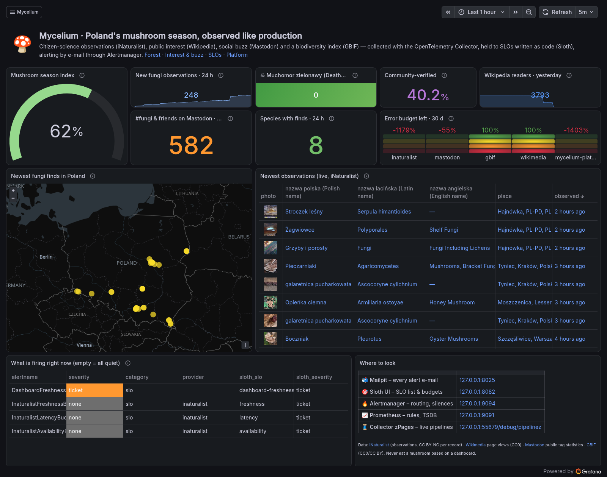
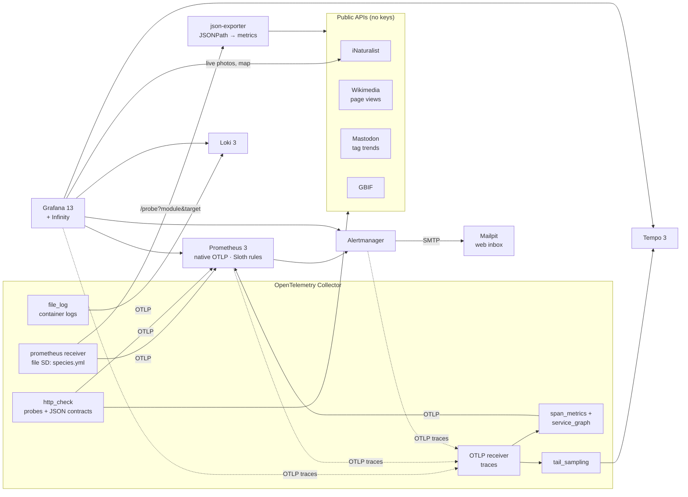
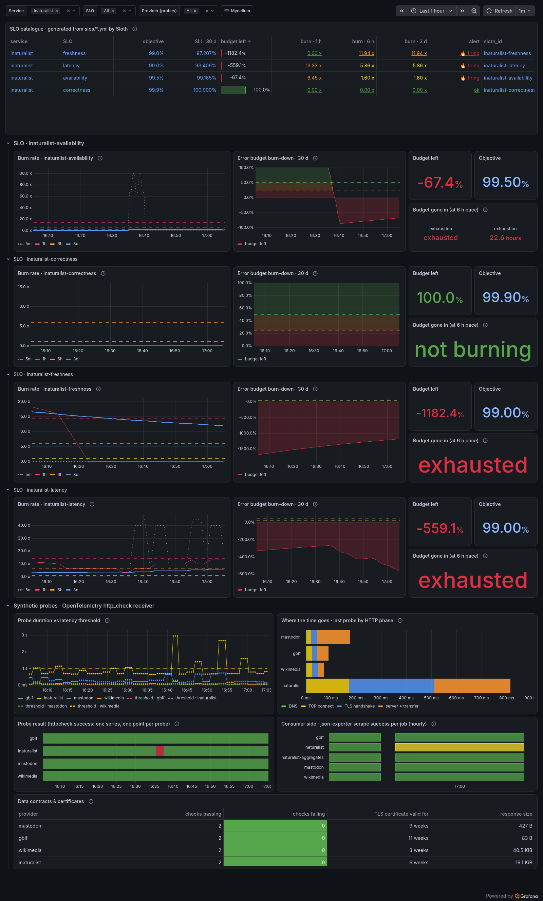
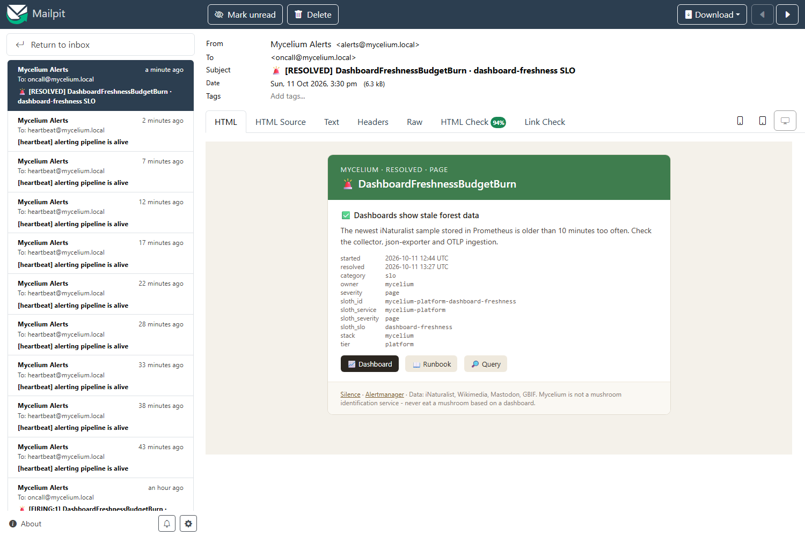
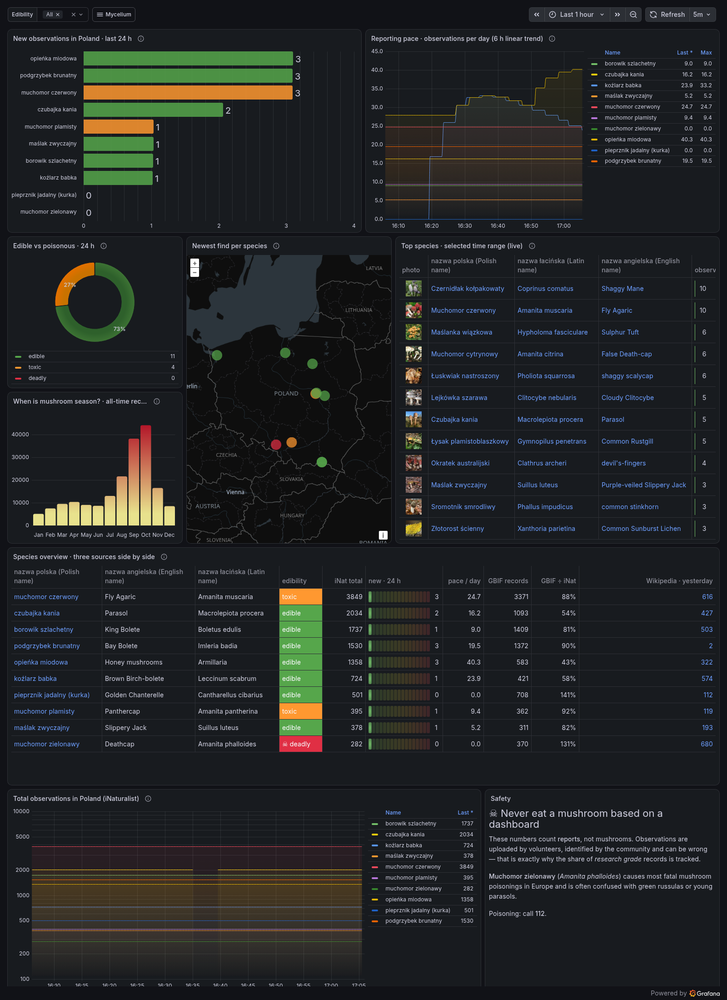
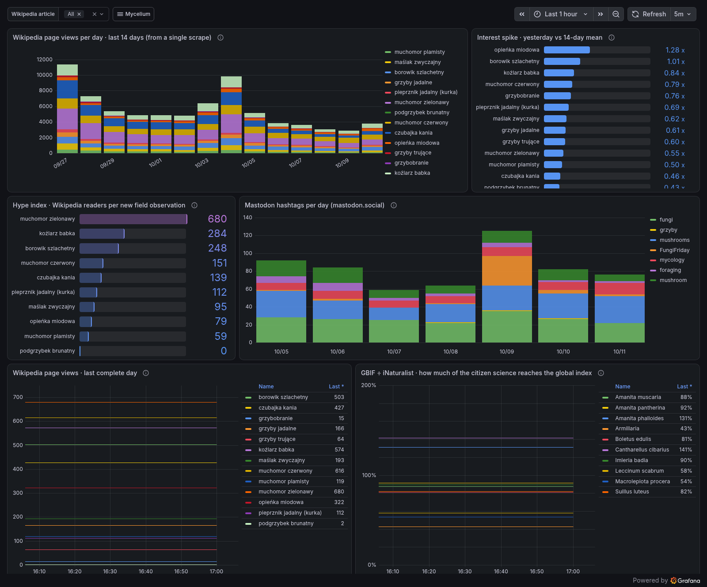
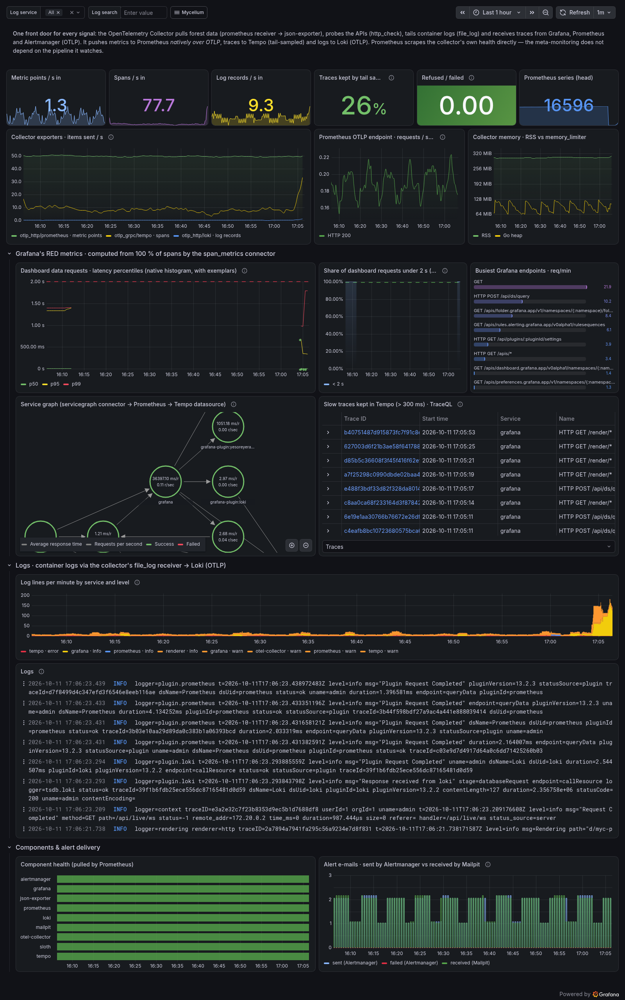
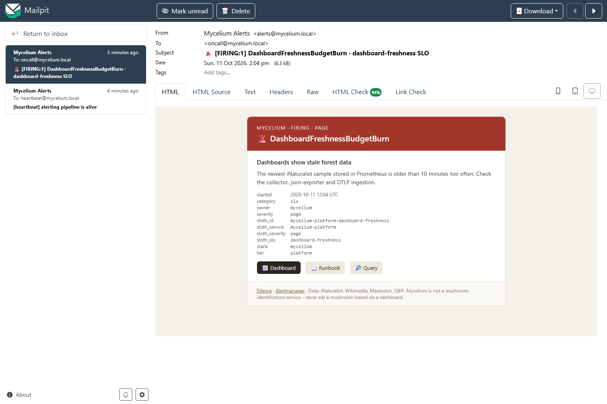

# 🍄 Mycelium

**Poland's mushroom season, observed like a production system.**

[](https://github.com/jeti20/mycelium/actions/workflows/ci.yml)
[](./LICENSE)

-E6522C?logo=prometheus&logoColor=white)


Every autumn half of Poland goes mushroom picking. Mycelium watches that season the way an SRE
team watches a service: **citizen-science observations** from iNaturalist, **public interest** from
Polish Wikipedia, **social buzz** from Mastodon and a **biodiversity index** from GBIF become
metrics, traces, logs, dashboards and e-mailed alerts. The four public APIs behind it get
**19 SLOs written as code**, multi-window multi-burn-rate alerts and an error budget policy — and
so does the platform itself.

Everything is configuration: an OpenTelemetry Collector, JSONPath, OTTL, PromQL, YAML SLO specs
and provisioned Grafana. **28 unit tests, a PromQL linter, routing tests and a drift check** run
in CI on every push.



<sub>Taken two hours after a clean start, right after the [game day](#game-day-breaking-it-on-purpose):
the negative budgets are a 20-minute outage measured against 30-day windows that so far contain
only two hours of data. Live data: iNaturalist observations and photos as they are uploaded.</sub>

> 🇵🇱 **Po polsku:** projekt portfolio z obserwowalności na temat grzybobrania. Zbiera dane
> z iNaturalist (obserwacje grzybów w Polsce), polskiej Wikipedii (zainteresowanie), Mastodona
> (hashtagi) i GBIF. Wszystko przechodzi przez **OpenTelemetry Collector** (metryki, ślady
> i logi) do Prometheusa (natywny OTLP), Tempo i Loki. **SLO są zapisane jako kod** (Sloth),
> mają burn-rate alerty według SRE Workbook, testy jednostkowe `promtool`, lint `pint` i testy
> routingu. Alerty idą z **Alertmanagera e-mailem** do lokalnej skrzynki Mailpit. Zero kodu
> aplikacji — sama konfiguracja. Start: `docker compose up -d` → http://127.0.0.1:3030.
> Wszystkie napotkane problemy, troubleshooting i wnioski: [`docs/dziennik-problemow.md`](docs/dziennik-problemow.md).

---

**Contents** · [What it demonstrates](#what-it-demonstrates) · [Run it](#run-it) ·
[Follow one data point](#follow-one-data-point) · [SLOs as code](#slos-as-code) ·
[Alerting](#alerting-grafana-or-alertmanager) · [OpenTelemetry pipeline](#the-opentelemetry-pipeline) ·
[Dashboards](#dashboards) · [Game day](#game-day-breaking-it-on-purpose) · [Field notes](#field-notes-what-the-data-taught-me) ·
[Proof, not promises](#proof-not-promises) · [Extend it](#extend-it) ·
[Data & polite polling](#data-sources-licences-and-polite-polling) · [Repository map](#repository-map) ·
[Limitations](#limitations-and-next-steps)

---

## What it demonstrates

| Topic | Where to look |
|---|---|
| **SLI/SLO design**: event-based vs time-based vs resampled SLIs, synthetic traffic for low-traffic dependencies, freshness and correctness as first-class SLIs | [`docs/slo-decisions.md`](docs/slo-decisions.md), [`prometheus/rules/sli.yml`](prometheus/rules/sli.yml) |
| **SLOs as code**: 573 lines of [Sloth](https://sloth.dev) specs → 4 702 lines of Prometheus rules, regenerated and diffed in CI | [`slos/`](slos), [`prometheus/rules/slo/`](prometheus/rules/slo) |
| **Burn-rate alerting** (SRE Workbook ch. 5): 14.4×/6× fast tier, 3×/1× slow tier, page only for what you own | [SLOs as code](#slos-as-code), unit tests in [`tests/slo_test.yml`](prometheus/tests/slo_test.yml) |
| **Error budget policy** and **runbooks** for every alert that reaches a human | [`docs/`](docs) |
| **OpenTelemetry Collector** as the single front door: prometheus, http_check, file_log and OTLP receivers; OTTL transforms; span_metrics and service_graph connectors; tail sampling | [`otel-collector/config.yaml`](otel-collector/config.yaml) |
| **Native OTLP into Prometheus 3** (no remote_write, no exporter), native histograms, exemplars | [`prometheus/prometheus.yml`](prometheus/prometheus.yml) |
| **Distributed tracing without writing an app**: Grafana, Prometheus and Alertmanager trace themselves | Platform dashboard, Tempo |
| **Three pillars wired together**: exemplar → trace → logs → trace | [`datasources.yaml`](grafana/provisioning/datasources/datasources.yaml) |
| **PromQL beyond the basics**: `delta` vs `increase` on gauges, `histogram_fraction` on native histograms, date math, `label_replace` geo, NaN guards, subqueries | [`forest.yml`](prometheus/rules/forest.yml), [Field notes](#field-notes-what-the-data-taught-me) |
| **Alertmanager**: routing tree, time intervals, inhibition, HTML e-mail templates, dead man's switch | [`alertmanager/`](alertmanager) |
| **Quality gates**: promtool (28 tests), pint, amtool routing tests, otelcol/Loki/Sloth validation, Sloth drift check | [`.github/workflows/ci.yml`](.github/workflows/ci.yml) |
| **Grafana**: Infinity + JSONata, image cells, Geomap, transformations (merge, join, grouping to matrix), repeated rows, node graph, TraceQL, logs | [`grafana/dashboards/`](grafana/dashboards) |

## Run it

**Needs:** Docker with Compose v2 and ~2 GB RAM. Nothing else — every tool runs in a container.

```bash
git clone https://github.com/jeti20/mycelium.git
cd mycelium
cp .env.example .env        # optional
docker compose up -d
```

| URL | What |
|---|---|
| http://127.0.0.1:3030 | **Grafana** — the home dashboard opens automatically (anonymous Editor) |
| http://127.0.0.1:8025 | **Mailpit** — the inbox where every alert e-mail lands |
| http://127.0.0.1:8082 | **Sloth UI** — SLO list, budgets and burn rates |
| http://127.0.0.1:9091 | Prometheus — rules, alerts, TSDB |
| http://127.0.0.1:9094 | Alertmanager — routing, silences |
| http://127.0.0.1:55679/debug/pipelinez | Collector zPages — live view of every pipeline |

The ports are deliberately unusual (3030, 9091, 9094) so Mycelium runs next to another local
Grafana/Prometheus. Everything binds to `127.0.0.1`. First data arrives within a minute,
Wikipedia, Mastodon and GBIF within 10 minutes; 24-hour deltas and 30-day budgets obviously need time.

## Follow one data point

Someone in a Masovian forest photographs a **King Bolete** (*Boletus edulis*) and uploads it to iNaturalist.
Here's everything that happens to it:



1. **Within 4 minutes** the collector's Prometheus receiver scrapes json-exporter with
   `target=https://api.inaturalist.org/v1/observations?taxon_id=48701&place_id=7800…`. The URL was
   built by relabeling from one line in [`species.yml`](otel-collector/species.yml); the same line
   also feeds the Wikipedia and GBIF jobs.
2. json-exporter turns `total_results` into `inat_observations{species="Boletus edulis",
   edibility="edible"}` and the newest observation into labels (coordinates, place, observer).
3. The collector pushes the samples to Prometheus over **native OTLP**.
4. Recording rules compute `forest:inat_new_observations:24h` with **`delta()`, not `increase()`**
   (the total is a gauge: a deleted record would look like a counter reset) and split
   `"51.0454,20.7969"` into `lat`/`lon` labels for the map.
5. On the Forest dashboard the bolete shows up in the 24 h bar chart, on the Geomap and in the
   species table, next to its Wikipedia readership and GBIF record count.
6. If it had been a **Deathcap** (*Amanita phalloides*), `DeathcapReported` would fire after 10
   minutes and Alertmanager would e-mail the *grzybiarze* (mushroom pickers) list — but not between
   22:00 and 07:00.
7. Meanwhile your dashboard refresh became a **trace**: Grafana → Prometheus (PromQL evaluation)
   → TSDB. The span_metrics connector turned it into a latency histogram *before* tail sampling
   decided whether to keep the trace. That histogram is the platform's **dashboard-latency SLO**.

## SLOs as code

SLOs live in [`slos/`](slos) as [Sloth](https://sloth.dev) specs. Sloth generates the recording
rules, budgets and multi-window multi-burn-rate alerts into
[`prometheus/rules/slo/`](prometheus/rules/slo); CI regenerates them and fails if the committed
rules drift from the specs. Anything that isn't a plain event stream is prepared first in
[`sli.yml`](prometheus/rules/sli.yml).

```yaml
# slos/inaturalist.yml (excerpt)
- name: availability
  objective: 99.5
  sli:
    events:
      error_query: |
        sum(count_over_time(httpcheck_success{provider="inaturalist"}[{{.window}}]))
        - sum(sum_over_time(httpcheck_success{provider="inaturalist"}[{{.window}}]))
      total_query: sum(count_over_time(httpcheck_success{provider="inaturalist"}[{{.window}}]))
  alerting:
    page_alert:   { labels: { severity: ticket } }   # someone else's outage never pages
    ticket_alert: { labels: { severity: none } }
```

### The catalogue

| Service | availability | latency | freshness | correctness |
|---|---|---|---|---|
| **iNaturalist** | 99.5 % of probes 2xx | 99 % 2xx in < 1.5 s | 99 % of time a new fungus appeared within 20 min | 99.9 % of contract checks pass |
| **Wikimedia** | 99.5 % | 99 % < 1 s | 99 % newest day ≥ day before yesterday | 99.9 % |
| **Mastodon** | 99.5 % | 99 % < 1 s | 99 % every tag reports today | 99.9 % |
| **GBIF** | 99 % | 98 % < 1 s | — (weekly batches, see decisions) | 99.9 % |

| Platform (we own it → pages) | Objective | SLI |
|---|---|---|
| **dashboard-latency** | 99 % < 2 s | `histogram_fraction(0, 2, …)` over Grafana's `POST /api/ds/query` spans (native histogram) |
| **dashboard-freshness** | 99.5 % | newest stored iNaturalist sample younger than 10 min |
| **alert-delivery** | 99.9 % | Alertmanager e-mail notifications failed ÷ total |
| **telemetry-ingestion** | 99.9 % | collector → Prometheus metric points failed ÷ total |

Every choice — why probes instead of scrapes, why these thresholds, why GBIF has no freshness SLO,
which weaknesses are accepted — is written down in
[**docs/slo-decisions.md**](docs/slo-decisions.md). What happens when a budget runs low is in the
[**error budget policy**](docs/error-budget-policy.md).

### Burn-rate alerts (generated)

| Tier | Long window | Short window | Burn rate | Budget spent when it fires | Platform | Upstream |
|---|---|---|---|---|---|---|
| fast | 1 h | 5 m | 14.4× | 2 % | **page** | ticket |
| fast | 6 h | 30 m | 6× | 5 % | **page** | ticket |
| slow | 1 d | 2 h | 3× | 10 % | ticket | none (recorded) |
| slow | 3 d | 6 h | 1× | 10 % | ticket | none (recorded) |



## Alerting: Grafana or Alertmanager?

Both can send alerts. Mycelium evaluates **all alert rules in Prometheus** and routes them with
**Alertmanager**, and Grafana only displays them (the Prometheus datasource exposes the rules
read-only under *Alerting*). Why:

| | Prometheus rules + Alertmanager ✅ | Grafana-managed alerting |
|---|---|---|
| Rules as code, reviewed in Git | plain YAML next to the recording rules | possible (provisioning), but exported JSON/YAML is verbose |
| **Unit tests** | `promtool test rules` — 28 tests here | no equivalent |
| Lint | `pint` | — |
| SLO tooling (Sloth, Pyrra, OpenSLO) | generates exactly this format | — |
| Inhibition, grouping, time intervals | mature, testable with `amtool` | available, less expressive inhibition |
| Survives Grafana being down | yes | no |
| Alert on non-Prometheus data (logs, SQL, APIs) | no | **yes — its real strength** |

Rule of thumb: alert in the system that owns the data and can be tested; reach for Grafana-managed
alerts when the data only exists behind a Grafana datasource.

```
route (group_by: alertname, provider, sloth_service, sloth_slo)
├── alertname=Watchdog   → heartbeat@   every 5 min (dead man's switch)
├── severity=page        → oncall@      immediately, 24/7, repeat 1 h
├── category=forest      → grzybiarze@  muted 22:00–07:00 Europe/Warsaw
├── severity=ticket      → tickets@     Mon–Fri 08:00–18:00 only
└── severity=none        → blackhole    (visible in UI and dashboards)

inhibit: fast burn ⟶ slow burn (same sloth_id)
         ProviderUnreachable ⟶ that provider's tickets and recorded alerts
         TelemetryPipelineDown ⟶ all data-quality and forest notices
```

E-mails are rendered by a custom HTML template ([`email.tmpl`](alertmanager/templates/email.tmpl))
and delivered over real SMTP to **Mailpit**, so the whole path is real without an external account.
Swap the smarthost and it's production mail. The **Watchdog** heartbeat closes the loop: Prometheus
scrapes Mailpit's `mailpit_smtp_accepted_total`, and `AlertPipelineHeartbeatMissing` fires if no
heartbeat arrived for 20 minutes. Routing is tested in CI with `amtool config routes test`
([`routing-tests.txt`](alertmanager/routing-tests.txt)).



## The OpenTelemetry pipeline

One collector, four receivers, three backends — [`otel-collector/config.yaml`](otel-collector/config.yaml):

| Pipeline | Receivers | Processing | Exporter |
|---|---|---|---|
| `metrics/forest` | `prometheus` (5 scrape jobs, file SD from `species.yml`) | batch | `otlp_http` → Prometheus `/api/v1/otlp` |
| `metrics/probes` | `http_check` (latency per HTTP phase, TLS expiry, gjson contract checks) | OTTL `copy_metric` → `httpcheck.success`, provider tagging, filter | `otlp_http` → Prometheus |
| `traces/ingest` → `traces/sampled` | `otlp` (Grafana, Prometheus, Alertmanager) | **span_metrics + service_graph on 100 %**, then tail sampling | `otlp_grpc` → Tempo |
| `metrics/traces` | span_metrics, service_graph connectors | batch | `otlp_http` → Prometheus |
| `logs` | `file_log` (Docker json logs) | filter own project, OTTL: service name, level, trace id | `otlp_http` → Loki `/otlp` |

Design decisions worth a look:

- **RED metrics before sampling.** Tail sampling keeps errors, traces > 500 ms, the whole
  alert-delivery path and a quarter of user requests, and drops Grafana's background noise. The
  span_metrics connector sits *in front of* the sampler, so latency SLOs see every request.
- **Two planes, two transports.** Forest data is pushed over OTLP; every component's own health is
  pulled by Prometheus directly. If the collector dies, Prometheus still knows (`TelemetryPipelineDown`).
- **No Docker API for logs.** Docker's json-file driver can copy container labels into every log
  line (`logging.options.labels` in compose). The collector reads the compose service name from
  there and sets `service.name`.
- **Traces from software you didn't write.** Grafana (`GF_TRACING_OPENTELEMETRY_*`), Prometheus
  (`tracing:`) and Alertmanager (`tracing:`) export OTLP spans, and W3C context propagates from
  Grafana into Prometheus. A dashboard refresh is one trace; an alert e-mail is another.
- **Wired pillars.** Exemplars on the latency histogram open the exact trace in Tempo; a span opens
  its service's logs in Loki; log lines with a trace id link back to Tempo.
- **Honest service names.** Grafana runs every datasource plugin as a child process that reports
  spans under the plugin id — so the Prometheus *plugin* called itself `prometheus`, just like the
  server. OTTL renames those processes to `grafana-plugin:<id>`: a trace now reads
  `grafana → grafana-plugin:prometheus → prometheus`.
- **Sample roots, trust parents.** Prometheus traced every rule evaluation (~300 spans/s). With
  `sampling_fraction: 0.02` and its parent-based sampler, Grafana-initiated queries are still traced
  end to end while self-initiated noise drops to ~5 spans/s.

## Dashboards

Five dashboards in three folders, provisioned from JSON in [`grafana/dashboards/`](grafana/dashboards).

| Dashboard | Highlights |
|---|---|
| **Mycelium** (home) | season index gauge, Deathcap counter, live map and photo table of the newest finds (Infinity), error budget per service, firing alerts |
| **Forest** | 24 h bars coloured by edibility, 6 h trend via `deriv()`, Geomap from `label_replace`d coordinates, top species for *any* time range (Infinity with `${__from:date}`), "when is mushroom season" from a JSONata-transformed histogram, a 6-query species table merged by label |
| **Interest & buzz** | 14 days of Wikipedia views from a single scrape (grouping to matrix), interest spike ratio, hype index, Mastodon hashtags per day, GBIF ÷ iNaturalist |
| **SLOs** | catalogue joined from 7 queries, a repeated row per SLO with burn rates against the MWMBR thresholds, burn-down, time-to-exhaustion; probe latency by HTTP phase, data contracts, TLS expiry |
| **Platform** | collector throughput and loss, Prometheus OTLP ingestion, Grafana latency percentiles from native histograms with exemplars, service graph, TraceQL search, logs by service and level, alert e-mails sent vs received |

<details>
<summary><b>Screenshots</b></summary>

**Forest**


**Interest & buzz**


**Platform**


Rendered with the bundled grafana-image-renderer (`make screenshots`).
</details>

## Game day: breaking it on purpose

Unit tests check what you anticipated. To check the rest, I stopped `json-exporter` for 20 minutes
on a running stack (Sunday afternoon, after the warm-up) and watched what happened:

| Time | What happened |
|---|---|
| 14:36:07 | `docker compose stop json-exporter` |
| 14:40:04 | `PlatformComponentDown` (ticket) — **not** e-mailed: tickets only go out Mon–Fri 08–18 |
| **14:44:15** | **page e-mailed to `oncall@`: `DashboardFreshnessBudgetBurn`** — 8 minutes after the failure; the slow-burn tier is inhibited |
| 14:52 | `InaturalistFreshnessBudgetBurn` — iNaturalist looked stale because *our* exporter was down ⚠️ |
| 14:56:15 | `docker compose start json-exporter` |
| 15:01 | `ConsumerScrapesFailing` fires — *after* the fix ⚠️ |
| **15:30:49** | **`[RESOLVED]` e-mail** — the 30-minute short window of the 6× tier had to clear first (by design) |
| 15:30 → ~17:00 | the slow-burn **ticket** tier takes over until its 2-hour short window clears (not mailed on a Sunday) |

Two flaws that 25 unit tests had not caught, both fixed and now covered by tests:

1. **Provider freshness was measured through our own exporter**, so our outage burned
   iNaturalist's budget. Provider freshness SLIs now go silent while our collection path is down
   (`platform:collection_path_up:bool`), and Alertmanager inhibits upstream alerts meanwhile.
   Measure the provider, not yourself.
2. **An alert with a 1-hour window fired after recovery** and would have hung around for an hour.
   `ConsumerScrapesFailing` now requires failures within the last 30 minutes.

Everything that went wrong while building Mycelium — symptoms, how I troubleshot it, what worked
and what didn't — is written up (in Polish) in [**docs/dziennik-problemow.md**](docs/dziennik-problemow.md).

## Field notes: what the data taught me

Things that broke, surprised me, or turned out to be wrong while building this. Each one left a
fix and, where possible, a unit test behind.

1. **`increase()` on a gauge is a 6× lie.** iNaturalist totals usually grow, but a deleted
   observation makes them drop by one. Prometheus treats any drop as a counter reset:
   in [`forest_test.yml`](prometheus/tests/forest_test.yml) one deletion makes `increase()` report
   **1 376** new observations where `delta()` reports the true **229**.
2. **A Wikipedia article with zero readers was a redirect.** "Zatrucie grzybami" (mushroom
   poisoning) showed ~0 views a day in the middle of the season. It's a redirect to "Grzyby
   trujące", and the API counts views of the redirect page itself. Same for "Opieńka". Lesson:
   verify the identity of what you measure, not just that it returns 200.
3. **The API omits days with zero views**, which broke my first freshness SLI. It required *every*
   article to have recent data (`min()`); a quiet article looked days behind although the dataset
   was fresh. Freshness belongs to the dataset → `max()`.
4. **OTLP has no staleness markers.** `httpcheck.status` has one series per status code; after a
   failure the old `code="200"` series stays visible for the 5-minute lookback and `max()` hides
   the outage. Fix: an OTTL `copy_metric` that produces exactly one series with one point per probe.
5. **One NaN poisons a month.** An alert-delivery SLI of `failed / total` is `0/0 = NaN` in any 5
   minutes without e-mails, and Sloth's 30-day SLI averages all 5-minute ratios. Guard:
   `(ratio) and on () (total > 0)`. Tested.
6. **A cold start paged me.** The first clean `docker compose up` sent a *page* within minutes:
   freshness SLIs treat "no data" as stale (on purpose), and right after a start there is no data
   yet — Wikimedia was polled every 15 minutes back then. Every restart would have woken someone up. Fix: a
   20-minute warm-up after Prometheus starts during which freshness SLIs emit no samples
   (`platform:prometheus_uptime:seconds`), plus a unit test for the cold start.
   <details><summary>The page it sent, 90 seconds after start</summary>

   
   </details>
7. **Rule groups have no order between them.** Latency thresholds and the Wikimedia date cut-off
   started in a separate group; for the first evaluation after a restart the SLIs read "bad" and
   burned budget. Constants and the rules using them now share one group (rules inside a group run
   in order).
8. **Collector self-metrics lost `_total`.** With 0.162 the internal Prometheus exporter exposed
   counters without the suffix, and every `rate()` got a "might not be a counter" notice.
   `without_type_suffix: false` brings back conventional names.
9. **Debugging Grafana with its own traces.** A Platform panel failed with *"vector cannot contain
   metrics with the same labelset"*. The error log carried a trace id, tail sampling keeps every
   error, and the trace in Tempo showed the culprit in one span attribute: a **LogQL** query sent to
   the **Prometheus** datasource (the panel's default datasource overrode the target's). One minute
   instead of clicking through 22 panels.
10. **Sunday is mushroom day.** Wikipedia views of mushroom articles peak on Sundays (27 Sep and 4 Oct 2026: picking days),
   and `#FungiFriday` on Mastodon spikes every Friday. The week shows up in the data before the
   weather does.

## Proof, not promises

```bash
make check     # or the individual commands below (Windows/Git Bash: prefix with MSYS_NO_PATHCONV=1)
docker compose run --rm otelcol-validate                  # collector config
docker compose run --rm sloth-validate                    # SLO specs
docker compose run --rm promtool check config /etc/prometheus/prometheus.yml
docker compose run --rm promtool test rules tests/sli_test.yml tests/slo_test.yml tests/forest_test.yml tests/platform_test.yml
docker compose run --rm pint                              # PromQL lint + house rules
docker compose run --rm amtool                            # Alertmanager config
docker compose run --rm amtool-routes                     # routing tests
docker compose run --rm loki-validate
```

**What the 28 unit tests prove**

- a hard outage trips the fast tier within minutes; a steady 2 % leak trips *only* the slow tier;
- a 200 OK with a broken payload burns correctness, not availability;
- latency needs speed **and** success; a frozen observation id or missing data is not fresh, but a cold start is not an outage, and neither is *our own* exporter being down (from the game day);
- PromQL date math produces `1970010400` on day 5; a quiet article doesn't make Wikimedia stale;
- the native-histogram latency SLI computes exactly 10 % errors and pages;
- no notifications → no SLI sample (not NaN);
- `increase()` vs `delta()`, the season index, coordinates from `label_replace`, a renamed label that
  must not double-count a species, the Deathcap and poisoning-interest notices;
- the dead man's switch, an absent collector, an unreachable provider, consumer-side failures that
  are suppressed while the provider is down and resolve soon after a fix, and totals going backwards.

**pint** enforces house rules on all 56 alerts (generated ones included): `severity` ∈
{none, ticket, page}, a `category`, a `summary`, and a runbook link for every page. CI also checks
that generated SLO rules match the specs, that dashboards are valid JSON with unique UIDs, and that
every YAML file parses. Dependabot keeps image tags current.

## Extend it

**Add a species** — one entry in [`otel-collector/species.yml`](otel-collector/species.yml). The
collector reloads file SD within a minute; iNaturalist, Wikipedia and GBIF jobs pick it up:

```yaml
- targets: [lactarius-deliciosus]
  labels: {species: Lactarius deliciosus, name_pl: mleczaj rydz, edibility: edible,
           taxon_id: "155197", gbif_key: "...", wiki_article: Mleczaj_rydz}
```

Each species costs ~360 iNaturalist calls a day; stay well under the budget below.

**Change an SLO** — edit `slos/*.yml` (or a threshold in `prometheus/rules/sli.yml`), then
`make slo` (validate → generate → reload). Run the tests; commit specs and generated rules together.

**Add a data source** — a json-exporter module (JSONPath), a scrape job in the collector, an
http_check target with a contract, a Sloth spec. No code.

**Edit dashboards** in the UI, then *Export → Save to file* into `grafana/dashboards/`.

## Data sources, licences and polite polling

| Source | Used for | Licence | Requests/day |
|---|---|---|---|
| [iNaturalist API](https://api.inaturalist.org/v1/docs/) | observation counts, newest finds, photos (Infinity) | data CC BY-NC per record (counts are facts); photos © observers | 13 targets × 360 + 720 probes ≈ **5 400** (+ dashboard views) — under iNaturalist's 10 000/day guidance |
| [Wikimedia Analytics API](https://doc.wikimedia.org/generated-data-platform/aqs/analytics-api/) | daily page views, pl.wikipedia | CC0 | 13 × 144 + 720 ≈ 2 600 |
| [Mastodon API](https://docs.joinmastodon.org/methods/tags/) (mastodon.social) | public hashtag statistics | public endpoint, no personal data stored | 7 × 144 + 720 ≈ 1 730 |
| [GBIF API](https://techdocs.gbif.org/en/openapi/) | occurrence counts | CC0 / CC BY per dataset | 11 × 144 + 720 ≈ 2 300 |

Every request carries a descriptive User-Agent. Please keep polling polite if you fork this, and
change the contact URL. **Mycelium is not a mushroom identification service — never eat a mushroom
based on a dashboard.** Poisoning: 112.

## Repository map

```
mycelium/
├── docker-compose.yml            # 10 services + 8 tools (profile "tools")
├── otel-collector/
│   ├── config.yaml               # receivers, OTTL, connectors, tail sampling, exporters
│   └── species.yml               # the species catalogue (file SD) - add a species here
├── json-exporter/config.yml      # JSONPath modules, one per API response shape
├── slos/*.yml                    # SLO specs (Sloth)  ──generate──▶  prometheus/rules/slo/
├── prometheus/
│   ├── prometheus.yml            # OTLP ingestion, tracing, platform scrapes
│   ├── rules/                    # sli.yml · forest.yml · data-quality.yml · platform.yml · slo/ (generated)
│   └── tests/                    # 28 promtool unit tests
├── alertmanager/                 # routing, inhibition, time intervals, e-mail template, routing tests
├── tempo/ · loki/                # backends (OTLP in)
├── grafana/                      # provisioning + 5 dashboards (Forest/, Reliability/, Platform/)
├── docs/                         # SLO decisions, error budget policy, runbooks, troubleshooting journal (PL), screenshots
├── .pint.hcl                     # PromQL lint rules
└── .github/                      # CI, Dependabot
```

## Limitations and next steps

- Single node, no HA, no long-term storage, local SMTP catcher. A portfolio project, not a
  production deployment — [SECURITY.md](SECURITY.md) lists what to change before exposing it.
- The dead man's switch can't page through the path it monitors; in production the Watchdog goes
  to an external service.
- Traces cover the read path (Grafana → Prometheus/Tempo/Loki) and alert delivery, not the data
  collection itself (json-exporter isn't instrumented).
- "New observations" counts uploads, not mushrooms: an evening upload of a morning's finds shows up
  in the evening.
- Ideas: weather-free fruiting forecast from the season index; OpenSLO export; Grafana-managed
  alerts on Loki for log-only conditions; Pyroscope profiles of the collector.

## License

Code: [MIT](./LICENSE) © 2026 jeti20. Data stays under its providers' terms (see above).
